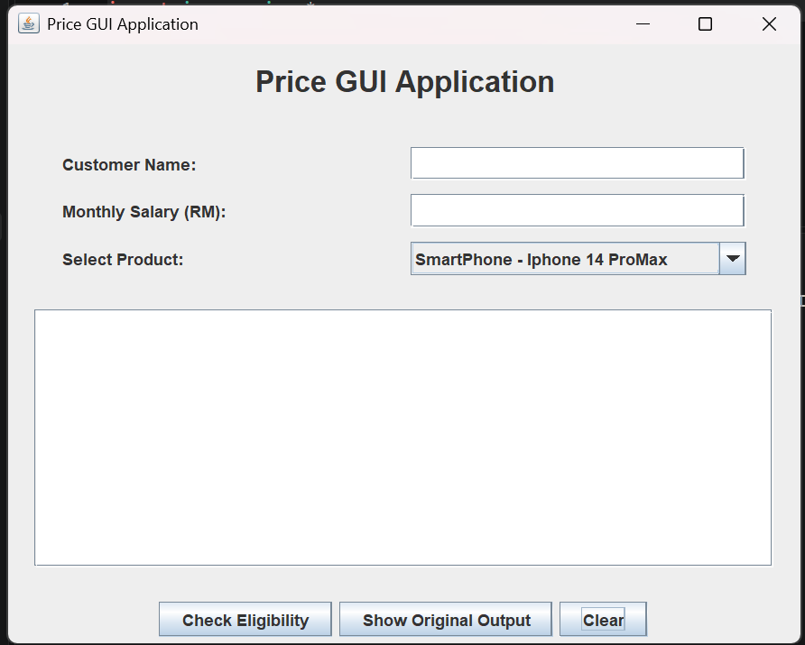

# Price GUI Application

## Project Description

This project demonstrates Object-Oriented Programming (OOP)
concepts using Java Swing and event handling.

The application allows users to enter customer information,
select a product, and check purchasing eligibility based
on the salary conditions in the original Java program.

## Features

- Enter customer name
- Enter monthly salary
- Select SmartPhone, Laptop, or Car
- Check purchasing eligibility
- Display product and customer information
- Show the original program output
- Clear all input fields

## Java Concepts Used

- Interface (Price)
- Classes and Objects
- Inheritance
- Polymorphism
- Method Overriding
- JFrame and JPanel
- JLabel and JTextField
- JComboBox and JButton
- ActionListener and ActionEvent
- Event Handling using actionPerformed()

## Salary Conditions

The original program uses the following conditions:

- SmartPhone: Salary greater than RM4,000
- Laptop: Salary greater than RM4,000
- Car: Salary greater than RM8,000

These conditions are preserved in the GUI.

## GUI Screenshot

## How to Run

1. Download the repository.
2. Open the project folder in VS Code.
3. Compile the Java files:

   javac PriceApp.java PriceGUI.java

4. Run the GUI:

   java PriceGUI

## Project Files

- PriceApp.java - Original Java program
- PriceGUI.java - Java Swing GUI implementation
- PriceGUI.png - GUI screenshot
